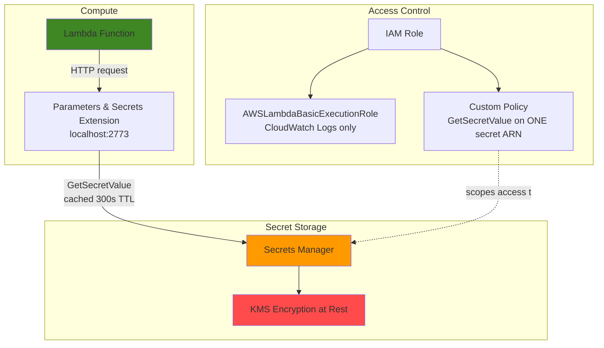

# Basic Secret Management with Secrets Manager and Lambda

I built a serverless setup that removes hardcoded credentials. A Lambda function retrieves a database secret from AWS Secrets Manager at runtime, using the AWS Parameters and Secrets Lambda Extension to cache it locally, instead of storing the credentials in code or environment variables.

> Based on the [Basic Secret Management with Secrets Manager and Lambda](https://github.com/mzazon/cloud-projects/blob/main/aws/basic-secret-management-secrets-lambda/basic-secret-management-secrets-lambda.md) project from [cloudprojects.dev](https://cloudprojects.dev/).

## The Problem

Credentials hardcoded in application code or stored in plain environment variables are visible to every developer with access to the repo. They stay in version control history even after they're "removed," and they can't be rotated without deploying new code. This setup moves the secret into an encrypted, access controlled service and retrieves it at runtime instead.

## Architecture

## What's in This Folder

| File | Contents |
|---|---|
| [`lambda_function.py`](./lambda_function.py) | The function code. It gets the secret through the extension's local HTTP endpoint instead of calling the Secrets Manager SDK directly. |
| [`trust-policy.json`](./trust-policy.json) | The IAM trust policy, which defines *who* can assume the Lambda's role |
| [`secrets-policy.json`](./secrets-policy.json) | The custom permissions policy, limited to one secret ARN (account ID redacted) |

## Security Choices

- **Two separate IAM policies instead of one.** `AWSLambdaBasicExecutionRole` (managed by AWS) only allows writing to CloudWatch Logs. A second, custom policy adds exactly one permission: `secretsmanager:GetSecretValue`. The role can write its own logs and read one secret, nothing more.
- **Limited to one specific secret, no wildcard.** The custom policy's `Resource` field is the exact ARN of the secret, not `"*"`. If this role's credentials were ever stolen, an attacker could read this one secret, not every secret in the account.
- **Secrets retrieved through the Lambda extension, not a direct SDK call.** The extension runs alongside the function inside the same environment and serves secrets over `localhost:2773` from an in-memory cache (300 second TTL here). That reduces both response time and Secrets Manager API costs when the function runs repeatedly.

## Proving the Cache Works

Timing alone can't prove the cache was used. A warm Lambda environment and a cache hit both just look "faster," and a simple before and after timer can't tell them apart. CloudWatch Logs settled it:

| Invocation | Duration | Init Duration present? |
|---|---|---|
| 1 (cold) | 355.87 ms | Yes (197.62 ms), cold start |
| 2 (warm) | 145.66 ms | No |
| 3 (warm) | **2.34 ms** | No |
| 4 (warm) | 14.68 ms | No |

Invocation 3 is the proof. At 2.34 ms total, there was no time for a network round trip to Secrets Manager. It was served entirely from the extension's local cache, and the request never left the Lambda environment.

## Problems I Found and Fixed

The original instructions had real gaps, not just style differences. Finding and fixing them was the most valuable part of the project:

- **A missing tool that failed silently.** `zip` wasn't installed on my system, but the script still printed `✅ ... packaged`, because it never checked whether the command before it succeeded. I verified the file with `ls -la` instead of trusting the checkmark, installed `zip`, and ran the packaging step again.
- **Running a command before the function was ready.** `create-function` returns before AWS finishes creating the function (`"State": "Pending"`), and the next command tried to modify it right away, which caused a `ResourceConflictException`. I fixed it with `aws lambda wait function-active`, which checks until the function is actually ready, instead of the `sleep 10` guess the instructions used elsewhere.
- **A second, less obvious timing gap.** Besides `State`, Lambda separately tracks `LastUpdateStatus`, which shows whether the latest configuration change (like attaching the extension layer) has finished. The `function-active` waiter doesn't check this. I noticed the layer still showed `LastUpdateStatus: InProgress` while the function was already `Active`, so I added `aws lambda wait function-updated` before invoking it.
- **My terminal lost its variables, not AWS.** Closing a terminal window ended the shell session holding all my `export`ed variables (`$SECRET_NAME`, `$LAMBDA_ROLE_ARN`, and others), and none of them were saved anywhere. I recovered by re-exporting the exact values from earlier command output. Regenerating the random suffix would have pointed to resource names that didn't exist.
- **Incomplete cleanup in the instructions.** The provided teardown never deleted the CloudWatch log group or the local `invocation-*.log` files from the caching test, so both would have been left behind. I added `aws logs delete-log-group` and removed the leftover files.

## Cost and Cleanup

The whole exercise cost an estimated **$0.05 to $0.10** (Secrets Manager storage plus small Lambda and API charges). I deleted the secret with `--force-delete-without-recovery`. That skips the default 30 day recovery window so the secret is gone and billing stops immediately. It was the right choice for throwaway test data, but it would be the wrong choice for any secret you might need to recover.

I deleted every resource (the Lambda function, IAM role, both policies, the secret, and the log group) and confirmed each one was actually gone, instead of assuming it from a successful command.

## Skills

- Least privilege IAM policy design
- AWS Secrets Manager
- AWS Lambda
- AWS Parameters and Secrets Lambda Extension
- Reading and interpreting CloudWatch Logs
- Debugging timing issues in AWS APIs
- AWS CLI waiters
