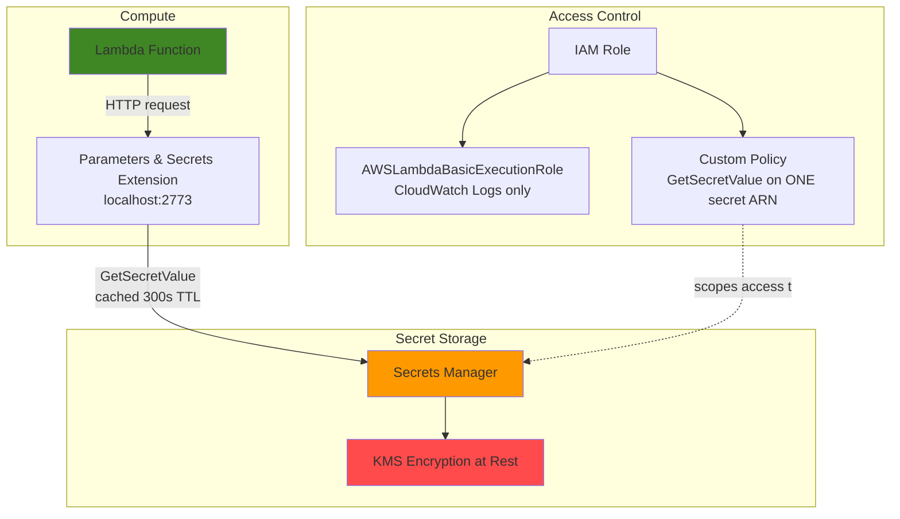

# Basic Secret Management with Secrets Manager and Lambda

A serverless pattern for eliminating hardcoded credentials: a Lambda
function retrieves a database secret at runtime from AWS Secrets Manager,
using the AWS Parameters and Secrets Lambda Extension for local caching,
rather than embedding credentials in code or environment variables.

## The problem this solves

> Based on the [Basic Secret Management with Secrets Manager and Lambda](https://github.com/mzazon/cloud-projects/blob/main/aws/basic-secret-management-secrets-lambda/basic-secret-management-secrets-lambda.md) project from [cloudprojects.dev](https://cloudprojects.dev/).

Hardcoded credentials in application code or plain environment variables
are visible to every developer with repo access, end up in version
control history even after "removal," and can't be rotated without a
code deployment. This pattern moves the secret into an encrypted,
access-controlled service and retrieves it programmatically at runtime
instead.

## Architecture

## What's in this repo

| File | Contents |
|---|---|
| [`lambda_function.py`](./lambda_function.py) | Handler that retrieves the secret via the Extension's local HTTP endpoint rather than calling the Secrets Manager SDK directly |
| [`trust-policy.json`](./trust-policy.json) | IAM trust policy — defines *who* can assume the Lambda execution role |
| [`secrets-policy.json`](./secrets-policy.json) | Custom permissions policy, scoped to one secret ARN (account ID redacted) |

## Security design choices

- **Two separate IAM policies, not one.** `AWSLambdaBasicExecutionRole`
  (AWS-managed) grants only CloudWatch Logs write access — nothing else.
  A second, custom policy grants exactly one additional permission:
  `secretsmanager:GetSecretValue`. The role can write its own logs and
  read one secret. Nothing more.
- **Resource-scoped, not wildcarded.** The custom policy's `Resource`
  field is the specific secret ARN, not `"*"`. If these credentials ever
  leaked, an attacker could read this one secret and not enumerate every
  secret in the account.
- **Retrieval via the Parameters and Secrets Lambda Extension**, not a
  direct SDK call. The extension runs as a sidecar process inside the
  execution environment, serving secrets over `localhost:2773` with a
  configurable in-memory cache (300s TTL here), which cuts both latency
  and Secrets Manager API costs on repeated invocations.

## Evidence the caching actually works

Wall-clock timing alone can't prove a cache hit — a warm Lambda execution
environment and an extension cache hit both look like "faster," and a
naive before/after timer can't tell them apart. CloudWatch Logs settled
it:

| Invocation | Duration | Init Duration present? |
|---|---|---|
| 1 (cold) | 355.87 ms | Yes (197.62 ms) — cold start |
| 2 (warm) | 145.66 ms | No |
| 3 (warm) | **2.34 ms** | No |
| 4 (warm) | 14.68 ms | No |

Invocation 3's 2.34ms total duration is the real proof: a live network
call to Secrets Manager cannot complete in 2.34 milliseconds. That
invocation was served entirely from the extension's local cache — the
API call never left the execution environment.

## Issues encountered and fixed

This project had real gaps in the original instructions, not just style
choices — worth documenting since finding and fixing them is the actual
work:

- **Missing dependency, silent failure.** `zip` wasn't installed on my
  system, and the script's `echo "✅ ... packaged"` printed regardless of
  whether the command above it succeeded — it always would, since nothing
  checked the exit status. Verified with `ls -la` instead of trusting
  the checkmark; installed `zip`, re-ran the packaging step.
- **Race condition on function creation.** `create-function` returns
  before AWS finishes provisioning (`"State": "Pending"`), but the very
  next command tried to modify that function immediately, causing a
  `ResourceConflictException`. Fixed with an explicit waiter
  (`aws lambda wait function-active`) instead of the `sleep 10` used
  elsewhere in the instructions — a poll-until-ready check rather than a
  guessed delay.
- **A second, subtler async gap.** Beyond `State`, Lambda tracks
  `LastUpdateStatus` separately — whether the most recent config change
  (like attaching the extension layer) has finished propagating. The
  `function-active` waiter doesn't check this at all. Used
  `aws lambda wait function-updated` before invoking, after noticing the
  layer attachment still showed `LastUpdateStatus: InProgress` even
  though the function itself was `Active`.
- **Terminal session, not AWS, lost state mid-project.** Closing a
  terminal window killed the shell process holding every `export`ed
  variable (`$SECRET_NAME`, `$LAMBDA_ROLE_ARN`, etc.) — none of that was
  ever persisted anywhere. Recovered by manually re-exporting the exact
  values from earlier command output rather than regenerating the random
  suffix, which would have pointed at resources that no longer matched.
- **Cleanup gaps in the original instructions.** The provided teardown
  never deleted the CloudWatch log group or the local `invocation-*.log`
  files from the caching test — both would have been left behind
  indefinitely. Added `aws logs delete-log-group` and a follow-up `rm`
  for the missed files.

## Cost and cleanup

Estimated cost for the full exercise: **$0.05–$0.10** (Secrets Manager
storage plus minimal Lambda/API charges). Torn down with
`--force-delete-without-recovery` on the secret — a deliberate choice
appropriate for throwaway demo data, since it forfeits the default
30-day recovery window in exchange for immediate deletion and immediate
billing stop. That tradeoff would be the wrong call for anything with
real recovery value.

Every resource (Lambda function, IAM role, both policies, the secret,
the log group) was deleted and independently verified as gone, not just
assumed from a clean exit code.

## Skills demonstrated

AWS IAM least-privilege policy design · AWS Secrets Manager · Lambda ·
the AWS Parameters and Secrets Lambda Extension · CloudWatch Logs
interpretation · debugging asynchronous AWS API behavior · AWS CLI
waiters
